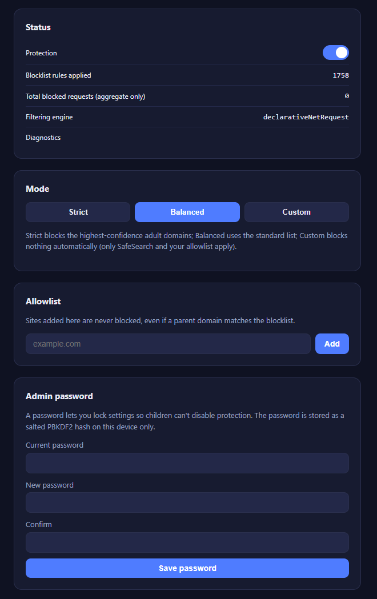
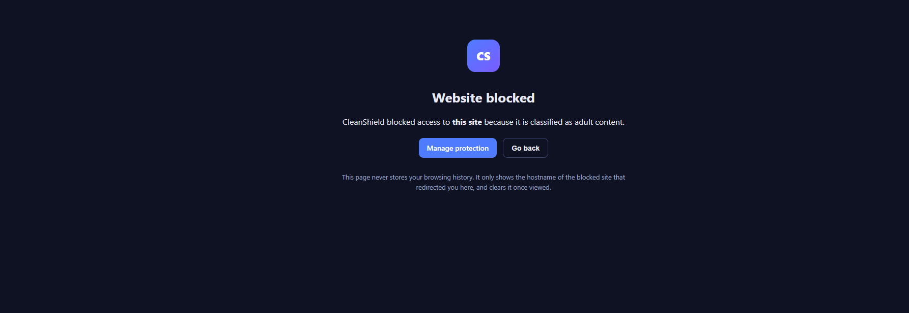
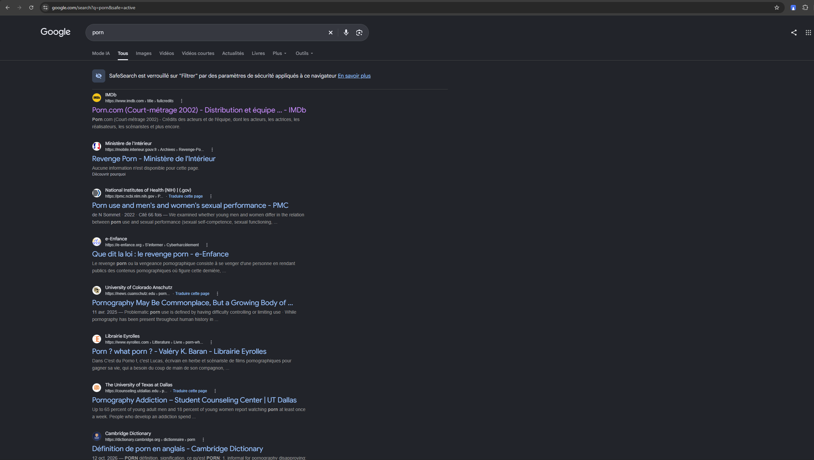

# CleanShield — Adult Content Blocker 🛡️

**CleanShield** is a fast, lightweight, and privacy-focused Chrome Extension (Manifest V3) designed to block adult websites, enforce SafeSearch, and protect browsing environments without logging or tracking user activity.

---

## ✨ Features

* **Privacy First:** CleanShield never logs or saves browsing history. Only an aggregate block count is retained locally.
* **Declarative Net Request Engine:** Built using modern MV3 APIs for high performance and low system overhead.
* **Flexible Filtering Modes:**
  * **Strict:** Maximum filtering using high-confidence adult blocklists.
  * **Balanced:** Standard protection against adult domains.
  * **Custom:** Filtering based on SafeSearch and your personal allowlist.
  **SafeSearch URL enforcement:** Adds the appropriate SafeSearch parameter to supported Google, Bing, DuckDuckGo, and Yandex search URLs. Filtering behavior depends on the search provider
     and its current implementation; this feature does not guarantee that every explicit result will be filtered.
* **Admin Password & Lock Mode:** Protect settings with a PBKDF2-hashed password to prevent unauthorized disabling or allowlist changes.
* **Custom Allowlist:** Easily whitelist trusted websites.
* 
  Settings Lock: A local password-protected settings interface designed to restrict changes to protection settings and the allowlist on the current device.
---

## 🛠️ Project Structure

* `manifest.json` — Extension configuration & permissions (Manifest V3).
* `background.js` — Service worker handling rule updates, navigation interception, and status messaging.
* `options.html` & `options.js` — Control panel for mode selection, allowlist management, and password protection.
* `blocked.html` & `blocked.js` — Clean redirection block page.
* `clean.css` — Modern Dark UI design system.
* `lib/filtering.js` — Core domain normalization and rule compilation.
* `rules/` — JSON datasets for strict, balanced, and allowlist rules.

---

## 🚀 How to Install (Developer Mode)

1. **Clone or download** this repository to your computer.
2. Open Google Chrome and go to `chrome://extensions/`.
3. Enable **Developer mode** using the toggle switch in the top-right corner.
4. Click **Load unpacked** in the top-left corner.
5. Select the `CleanShield` folder containing `manifest.json`.

---

## 🔒 Privacy & Security

CleanShield is designed to operate locally in the browser without sending browsing activity to a remote analytics or tracking service.

- **Local settings:** Protection preferences, filtering mode, allowlist entries, and the salted PBKDF2 password hash are stored locally using Chrome storage.
- **Minimal block information:** The extension temporarily stores the hostname and timestamp of the most recent blocked navigation so the block page can display the information. That record is cleared when the block page reads it.
- **Aggregate count:** A local counter records blocked navigations.
- **Permissions:** The extension requests browser permissions needed for its filtering and SafeSearch functionality. See the manifest and permission explanations for details.
- **Settings lock:** The password lock restricts changes through CleanShield's settings interface on this device. It does not prevent someone with control of the browser from disabling or uninstalling the extension.

CleanShield does not intentionally transmit this locally stored information to an external server. This description should be kept consistent with the actual source code and any future changes.

## 📸 Screenshots

### Settings

### Blocked page

### SafeSearch

